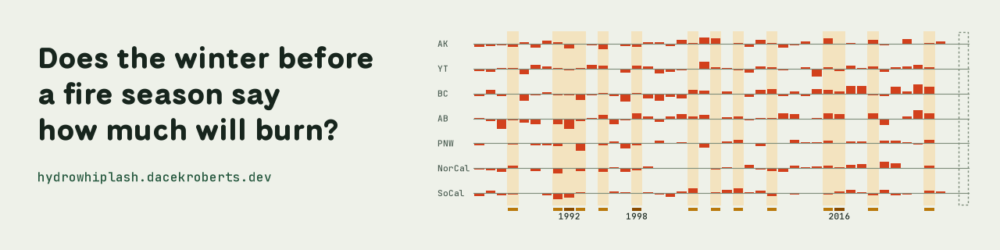

<picture>
  <source media="(prefers-color-scheme: dark)" srcset="results/figures/banner_readme_dark.png">
  
</picture>

# hydrowhiplash-elnino26

A strong El Niño winter tells us little about the fire season that follows
it in western North America. Of 52 tests fixed in advance, 4 are
significant after correcting for the number of tests, and none of the 4
links El Niño itself to burned area. What shows up is the step after it:
winter moisture goes with burned area in Alberta and Northern California.
These are associations over about 42 fire seasons, not causes.

**Site:** https://hydrowhiplash.dacekroberts.dev (overview, map, tracker,
methods and limitations, flowchart).

Author: Dace Roberts.

## What this is

An analog study: it asks what past El Niño winters were followed by, in
seven regions. The regions are the Pacific Northwest (Washington, Oregon,
Idaho), British Columbia, Alberta, Alaska, Yukon, Northern California and
Southern California. Climate data runs from 1950 and fire data from 1984.

The target is the 2026-27 El Niño and the 2027 fire season. The forecast
for 2027, this winter's months and the check against what burns are not
here yet. They arrive on the dates listed on the site's tracker page.

## How it was kept honest

- **The tests were written down first.** `ANALYSIS_PLAN.md` was committed
  and tagged (`analysis-plan-frozen`) before any fire data was analysed.
  A check in `scripts/` fails if the plan changes above its log of
  deviations.
- **The tests ran once.** The registered run is in `results/tables/run1/`
  and is never edited.
- **Every departure is logged.** `docs/plan_deviations.md` records where
  the work left the plan, and `DECISIONS.md` gives the reasoning for each
  judgment call.
- **Nulls are reported.** The methods page lists every test, including
  the 48 that are not significant after correction.

## Method in one table

| Question | Method |
|---|---|
| Do El Niño years differ from the rest? | Permutation test and bootstrap confidence interval |
| Does El Niño strength matter after controlling for temperature and the long-term trend? | Regression with controls and Newey-West standard errors |
| Does El Niño affect the northern regions differently from California? | Pooled regression with an El Niño × region interaction |
| Does a wet year raise fire risk afterwards (the whiplash mechanism)? | Lagged regression |
| Are consecutive years independent? | Autocorrelation check and block bootstrap |
| Are some results significant by chance? | Holm and Benjamini-Hochberg corrections |

The fire record holds few El Niño years, so every method was chosen for
small samples where one year resembles the next.

## What it doesn't show

It doesn't show that El Niño causes or prevents fire anywhere. It doesn't
yet hold a forecast. And about 42 seasons is a short record: an effect too
small for these tests to find could still be real.

## Where things are

```
src/              reusable code; config.py holds every tunable value
tests/            pytest checks
scripts/          repo checks, the log helper, the site upload
notebooks/        exploration
results/          figures and tables the site reads (run1/ is the registered run)
site/             the Quarto site
docs/             data dictionary, methods register, deviations, audits
logs/             daily progress logs
data/             downloads and processed files (not committed)
```

`DATA_SOURCES.md` lists every dataset with its licence.

## Running it

The data is not in this repository. Each source has a download script in
`src/` and a row in `DATA_SOURCES.md`; ERA5-Land needs a free Copernicus
account and its licence accepted.

```bash
mamba env create -f environment.yml
```

```bash
conda activate whiplash
```

```bash
python -m pytest
```

Modules run from the repository root as `python -m src.<module>`.

## AI use

I directed this project and made its key decisions. An AI assistant,
Claude Code, wrote most of the code. The methods page says how, and
`DECISIONS.md` logs it.

## Licensing

Code is MIT-licensed (`LICENSE`). Writing and figures are © 2026 Dace
Roberts, all rights reserved (`LICENSE-CONTENT`). Third-party data stays
under its publishers' terms (`DATA_SOURCES.md`).
